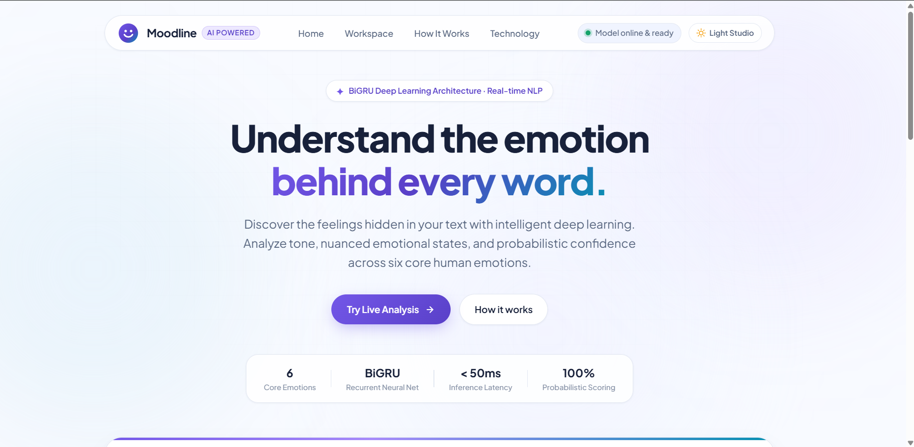
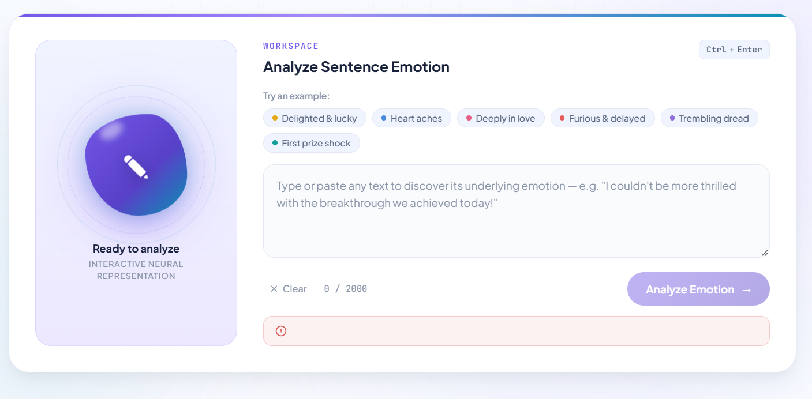
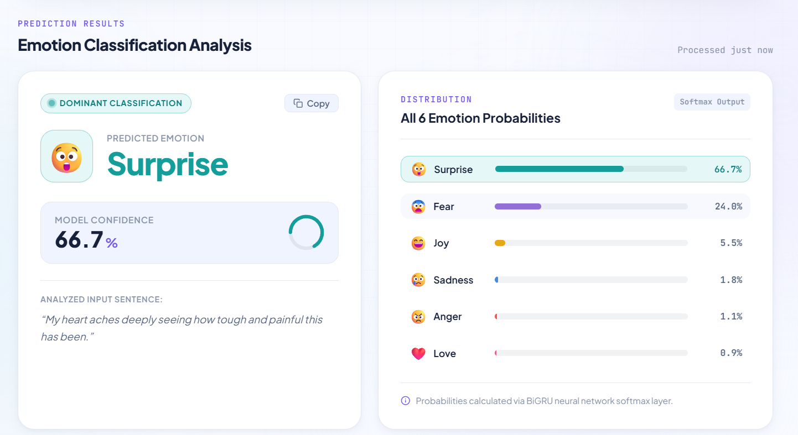
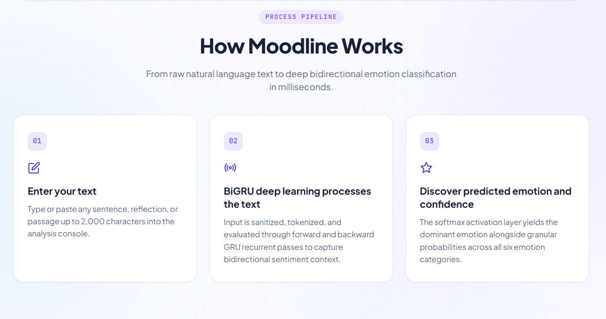
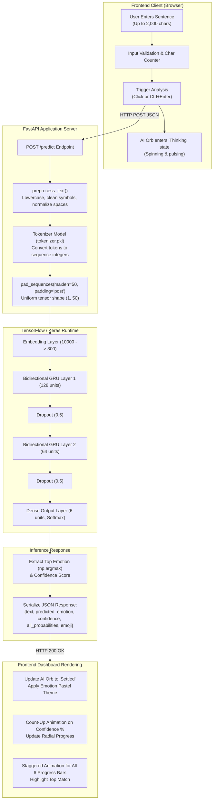

<div align="center">

# Moodline — AI-Powered Emotion Prediction System

<p align="center">
  <strong>An intelligent sentiment and emotion classification system powered by Bidirectional Gated Recurrent Units (BiGRU), FastAPI, and a modern motion-crafted web interface.</strong>
</p>

[](https://www.python.org/)
[](https://fastapi.tiangolo.com/)
[](https://www.tensorflow.org/)
[](https://keras.io/)
[](LICENSE)
[]()

<br />

<p align="center">
  <a href="#-project-overview">Overview</a> •
  <a href="#-key-features">Key Features</a> •
  <a href="#-application-screenshots">Screenshots</a> •
  <a href="#-system-architecture">Architecture</a> •
  <a href="#-machine-learning-methodology">ML Pipeline</a> •
  <a href="#-bigru-model-architecture">Model Details</a> •
  <a href="#-technology-stack">Tech Stack</a> •
  <a href="#-api-documentation">API Docs</a> •
  <a href="#-installation-and-setup">Quick Start</a>
</p>

</div>

---

## 📖 Table of Contents

- [Project Overview](#-project-overview)
- [Key Features](#-key-features)
- [Application Screenshots](#-application-screenshots)
- [System Architecture](#-system-architecture)
- [Machine Learning Methodology](#-machine-learning-methodology)
  - [Dataset Description](#dataset-description)
  - [Data Preprocessing & Tokenization](#data-preprocessing--tokenization)
  - [Comparative Model Benchmark](#comparative-model-benchmark)
- [BiGRU Model Architecture](#-bigru-model-architecture)
  - [Why Bidirectional Sequence Processing?](#why-bidirectional-sequence-processing)
  - [Layer-by-Layer Network Design](#layer-by-layer-network-design)
- [Technology Stack](#-technology-stack)
- [Project Directory Structure](#-project-directory-structure)
- [Installation and Setup](#-installation-and-setup)
- [Running the Application](#-running-the-application)
- [API Documentation](#-api-documentation)
  - [`GET /health`](#get-health)
  - [`POST /predict`](#post-predict)
- [Model Output & Probability Distribution](#-model-output--probability-distribution)
- [UI/UX Design System](#-uiux-design-system)
- [Limitations](#-limitations)
- [Future Improvements](#-future-improvements)
- [Deployment](#-deployment)
- [Author and Contact](#-author-and-contact)

---

## 🌟 Project Overview

**Moodline** is a production-grade, AI-powered text emotion prediction system that analyzes natural language sentences and classifies their underlying emotional state into one of six core human emotions:

$$\text{Emotions} = \{\text{Sadness}, \text{Joy}, \text{Love}, \text{Anger}, \text{Fear}, \text{Surprise}\}$$

### Why Emotion Prediction Matters

Written text carries immense semantic nuance, but lacks vocal intonation, pitch, and facial expressions. Traditional lexicon-based approaches (such as dictionary lookup and simple keyword matching) often fail when encountering subtle emotional cues, negated phrases, or evolving contexts.

Emotion classification addresses vital challenges across industries:
- **Customer Support Intelligence**: Prioritizing urgent tickets based on expressed anger or frustration.
- **Mental Wellness Journaling**: Tracking user sentiment trends over time with granular emotional indicators.
- **Brand & Social Monitoring**: Identifying positive excitement (joy, love) versus alarming spikes (anger, fear) in user feedback.
- **Conversational AI Enhancement**: Enabling conversational agents to tailor empathy levels to human emotion.

### How Deep Learning Solves This

Rather than evaluating words in isolation, **Moodline** leverages a **Bidirectional Gated Recurrent Unit (BiGRU)** neural network trained on sequence tokens. By evaluating sentences in both forward and backward directions simultaneously, the network preserves syntactic dependencies and sentence-level context. The model generates both a categorical prediction and a calibrated **Softmax probability distribution** across all six emotions.

---

## ⚡ Key Features

- **Bidirectional GRU Deep Learning**: High-accuracy sequence modeling ($91.20\%$ test accuracy) capturing forward and backward semantic dependencies.
- **Six Emotion Categories**: Evaluates text across *Sadness*, *Joy*, *Love*, *Anger*, *Fear*, and *Surprise*.
- **Real-Time Probabilistic Inference**: Computes softmax probabilities across all six classes simultaneously.
- **Confidence Metric with Dynamic Count-Up**: Numerical confidence scoring with radial progress visualization and ease-out animated counter.
- **Interactive AI Signature Orb**: A morphing gradient orb that reflects model state:
  - *Idle*: Gentle breathing and organic shape shifting.
  - *Inference*: High-speed rotation and energetic pulsation.
  - *Settled*: Dynamic color shift matching the detected emotion's color scheme.
- **Quick-Test Example Chips**: Instant sample sentences covering each emotion for one-click testing.
- **Input Controls & Character Validation**: 2,000-character capacity, real-time character count indicator, warning indicators, and a one-click clear button.
- **Keyboard Shortcut**: Instant analysis via <kbd>Ctrl</kbd> + <kbd>Enter</kbd> (or <kbd>Cmd</kbd> + <kbd>Enter</kbd> on macOS).
- **Automated Health Check Polling**: Frontend continuously polls `/health` to ensure the BiGRU model is loaded before accepting user input.
- **One-Click Result Summary Copy**: Copies the full analysis breakdown to the clipboard in clean formatted text.
- **Modern Responsive Light Theme**: Glassmorphism, subtle micro-grid, soft ambient blur canvas, and seamless layout adaptation for desktop, tablet, and mobile.

---

## 📸 Application Screenshots

> **Note**: Screenshot image assets are stored in the `docs/images/` directory. If you are viewing this repository before capturing production screenshots, place your PNG image files directly into [`docs/images/`](docs/images/README.md).

| View | Screenshot |
| :--- | :--- |
| **Hero & Workspace** | <br><sub>*Landing view featuring the gradient headline, live metrics, and interactive console.*</sub> |
| **Analysis Console & AI Orb** | <br><sub>*Interactive input card, character counter, sample chips, and signature AI orb.*</sub> |
| **Prediction Result** | <br><sub>*Dominant emotion card displaying dynamic pastel backdrop, confidence meter, and echoed text.*</sub> |
| **Probability Breakdown** | <br><sub>*Ranked distribution across all six classes with animated progress bars and top match badge.*</sub> |
| **Mobile Responsiveness** | <br><sub>*Optimized single-column layout for smartphone viewports.*</sub> |

---

## 🏗️ System Architecture

The end-to-end inference workflow operates as follows:



---

## 🔬 Machine Learning Methodology

### Dataset Description

The deep learning model was trained using the verified [dair-ai/emotion](https://huggingface.co/datasets/dair-ai/emotion) dataset from Hugging Face:
- **Corpus**: English Twitter messages annotated with six emotion classifications.
- **Classes**: `sadness` (0), `joy` (1), `love` (2), `anger` (3), `fear` (4), `surprise` (5).
- **Splits Used**: Official `train` split for network optimization and `test` split for unbiased evaluation.

### Addressing Class Imbalance

To prevent model bias toward majority classes (`joy` and `sadness`), class weights were mathematically computed using Scikit-Learn's balanced heuristic:

$$w_j = \frac{N}{K \cdot N_j}$$

Where $N$ is total samples, $K$ is the number of classes (6), and $N_j$ is the frequency of class $j$.

The calculated class weights applied during training:

| Class Index | Emotion | Computed Balanced Weight |
| :---: | :---: | :---: |
| `0` | **Sadness** | `0.5715` |
| `1` | **Joy** | `0.4973` |
| `2` | **Love** | `2.0450` |
| `3` | **Anger** | `1.2351` |
| `4` | **Fear** | `1.3767` |
| `5` | **Surprise** | `4.6620` |

### Data Preprocessing & Tokenization

1. **Text Normalization**: Text is converted to lowercase, special apostrophes and symbols are stripped, and whitespace is trimmed.
2. **Vocabulary Indexing**:
   - Total vocabulary extracted: **15,213 unique words**.
   - Maximum vocabulary size retained: **10,000 words** (`max_words = 10000`).
   - Out-of-Vocabulary handling: Assigned via `oov_token=''`.
3. **Sequence Length Normalization**:
   - Sentences converted into numerical token arrays.
   - Padded / truncated to **50 timesteps** with `padding='post'` and `truncating='post'`.

### Comparative Model Benchmark

During the research phase documented in `Code.ipynb`, four distinct recurrent neural network architectures were implemented, trained under identical conditions, and evaluated against the held-out test set:

| Model Architecture | Test Loss | Test Accuracy | Observations |
| :--- | :---: | :---: | :--- |
| **SimpleRNN** (Vanilla) | `1.7542` | `14.60%` | Suffered from severe vanishing gradients; unable to learn long-range emotional context. |
| **Unidirectional GRU** | `1.7782` | `14.35%` | Single-direction gating without bidirectional context failed to converge effectively. |
| **Stacked LSTM** | `0.4087` | `88.50%` | Strong convergence over 16 epochs, effectively retaining long-term dependencies. |
| **Bidirectional GRU (BiGRU)** | **`0.1961`** | **`91.20%`** | **Top Performer**: Bidirectional context coupled with GRU computational efficiency achieved superior loss and accuracy. |

---

## 🧠 BiGRU Model Architecture

### Why Bidirectional Sequence Processing?

In natural language, the emotion of a statement often hinges on dependencies that appear at the beginning or end of a sentence:
> *"I never imagined after all this time that we would actually pull this off!"*

A forward-only RNN parses words from left to right, meaning that by the time it reaches the final token, early context may be diluted. A **Bidirectional GRU** runs two independent recurrent passes on the word vectors:
1. **Forward Pass ($\vec{h}_t$)**: Sequences processed from timestep $t=1 \to T$.
2. **Backward Pass ($\overleftarrow{h}_t$)**: Sequences processed from timestep $t=T \to 1$.

At each timestep, the representations are concatenated:

$$h_t = [\vec{h}_t \,\|\, \overleftarrow{h}_t]$$

This ensures every word representation contains full past and future context.

### Layer-by-Layer Network Design

The production model saved at `Artifacts/BiGRU_Model.keras` has the following layer structure:

```
Input: Padded Integer Sequence [batch_size, 50]
  │
  ▼
[1] Embedding Layer
    • Vocabulary Size: 10,000
    • Embedding Dimension: 300
    • Input Length: 50
    • Output Shape: [batch_size, 50, 300]
  │
  ▼
[2] Bidirectional GRU (Layer 1)
    • Units: 128 (Forward: 128, Backward: 128)
    • return_sequences = True
    • Output Shape: [batch_size, 50, 256]
  │
  ▼
[3] Spatial Dropout (Rate: 0.5)
  │
  ▼
[4] Bidirectional GRU (Layer 2)
    • Units: 64 (Forward: 64, Backward: 64)
    • return_sequences = False
    • Output Shape: [batch_size, 128]
  │
  ▼
[5] Dropout (Rate: 0.5)
  │
  ▼
[6] Dense Output Layer
    • Units: 6 (num_classes)
    • Activation: Softmax
    • Output Shape: [batch_size, 6]
```

#### Training Configuration:
- **Loss Function**: `sparse_categorical_crossentropy`
- **Optimizer**: `adam`
- **Batch Size**: `32`
- **Callbacks**: `EarlyStopping(monitor='val_loss', patience=3, restore_best_weights=True)`
- **Convergence**: Best weights achieved at Epoch 2 ($val\_loss = 0.1961$), automatically restored.

---

## 💻 Technology Stack

| Category | Technology | Version | Purpose in Project |
| :--- | :--- | :--- | :--- |
| **Language** | **Python** | `3.11.9` | Primary runtime for training, modeling, and backend service. |
| **Deep Learning** | **TensorFlow** | `2.17.0` | ML computational framework and tensor graph execution. |
| **High-Level API** | **Keras** | `3.x` | Neural network construction (`Sequential`, `Bidirectional`, `GRU`). |
| **API Framework** | **FastAPI** | `0.115.0` | Asynchronous REST API routing, lifespan management, and static file serving. |
| **ASGI Server** | **Uvicorn** | `0.30.6` | High-performance ASGI production server. |
| **Data Validation** | **Pydantic** | `2.9.2` | Strong typing, input bounds validation (1–2000 chars), and JSON schemas. |
| **Math & Matrices** | **NumPy** | `1.26.4` | Array operations, label argmax decoding, and tensor manipulation. |
| **HDF5 Storage** | **h5py** | `3.11.0` | Binary persistence of weights and neural network graphs. |
| **Model Serialization** | **Pickle** | Built-in | Serializing and loading the fitted Keras `Tokenizer`. |
| **Frontend Core** | **HTML5 / CSS3 / JS** | ES6+ | Lightweight vanilla frontend without heavy framework overhead. |
| **Typography** | **Google Fonts** | — | Plus Jakarta Sans & JetBrains Mono typography. |

---

## 📁 Project Directory Structure

```plaintext
Emotion-Prediction/
├── .gitignore               # Git ignore rules for caches, venv, and checkpoints
├── requirements.txt         # Pinned production Python dependencies
├── runtime.txt              # Target platform runtime (python-3.11.9)
├── Code.ipynb               # Jupyter notebook with EDA, training, and evaluation
├── main.py                  # FastAPI application, prediction endpoints & lifespans
│
├── Artifacts/               # Serialized production model artifacts
│   ├── BiGRU_Model.keras    # Trained BiGRU neural network weights (~41.5 MB)
│   └── tokenizer.pkl        # Serialized Keras Tokenizer vocabulary (~607 KB)
│
├── static/                  # Client-side web assets
│   ├── index.html           # Semantic HTML5 layout and accessibility markers
│   ├── style.css            # Custom light-mode design system & animations (~36 KB)
│   └── script.js            # Vanilla JS for async API calls, UI states & counters
│
└── docs/                    # Documentation resources
    └── images/              # Screenshot storage for README
        └── README.md        # Instructions for screenshot placement
```

---

## ⚙️ Installation and Setup

### Prerequisites

Ensure you have **Python 3.11** installed. Verify using:
```powershell
python --version
```

> **Why Python 3.11?** Per `runtime.txt`, `tensorflow-cpu==2.17.0` has prebuilt Windows wheels optimized for Python 3.11.

### Step-by-Step Installation (Windows PowerShell)

1. **Clone the repository:**
   ```powershell
   git clone https://github.com/p1nak/Moodline-AI-Powered-Emotion-Prediction-System.git
   cd Emotion-Prediction
   ```

2. **Create a clean virtual environment:**
   ```powershell
   python -m venv venv
   ```

3. **Activate the virtual environment:**
   ```powershell
   .\venv\Scripts\Activate.ps1
   ```
   *(If script execution is disabled on your system, run: `Set-ExecutionPolicy -Scope Process -ExecutionPolicy Bypass`)*

4. **Install pinned dependencies:**
   ```powershell
   python -m pip install --upgrade pip
   python -m pip install -r requirements.txt
   ```

5. **Verify model artifact availability:**
   Ensure both model files exist in the `Artifacts/` directory:
   ```powershell
   Get-ChildItem Artifacts
   ```
   You should see:
   - `BiGRU_Model.keras`
   - `tokenizer.pkl`

---

## 🚀 Running the Application

### Start the FastAPI Server

Launch the ASGI server with hot-reload enabled:

```powershell
python -m uvicorn main:app --reload
```

Output should indicate:
```plaintext
Loading the model and tokenizer...
Model and tokenizer loaded successfully!
INFO:     Uvicorn running on http://127.0.0.1:8000 (Press CTRL+C to quit)
```

### Access Points

| Resource | URL | Description |
| :--- | :--- | :--- |
| **Web Interface** | `http://127.0.0.1:8000/` | Main interactive user interface. |
| **Interactive API Docs** | `http://127.0.0.1:8000/docs` | Swagger UI for interactive API testing. |
| **ReDoc Specification** | `http://127.0.0.1:8000/redoc` | Alternative OpenAPI documentation view. |
| **Health Check** | `http://127.0.0.1:8000/health` | Model status verification endpoint. |

---

## 🔌 API Documentation

### `GET /health`

Checks if the FastAPI server is running and the BiGRU model is loaded in memory.

#### Response (`200 OK`)
```json
{
  "status": "Server is running",
  "model_loaded": true
}
```

---

### `POST /predict`

Analyzes the emotional polarity of a submitted sentence.

#### Headers
```http
Content-Type: application/json
```

#### Request Body
```json
{
  "text": "I can't believe how lucky and delighted we are today!"
}
```

#### Request Constraints
- `text`: String, minimum 1 character, maximum 2,000 characters.

#### Response (`200 OK`)
```json
{
  "text": "I can't believe how lucky and delighted we are today!",
  "predicted_emotion": "joy",
  "confidence": 0.9421589374542236,
  "all_probabilities": {
    "sadness": 0.00384102831594646,
    "joy": 0.9421589374542236,
    "love": 0.03140284866094589,
    "anger": 0.003112948266789317,
    "fear": 0.004812049213796854,
    "surprise": 0.01467218808830142
  },
  "emoji": "😄"
}
```

#### Error Responses

| Status Code | Reason | Example Response Body |
| :---: | :--- | :--- |
| `400 Bad Request` | Input is empty after preprocessing. | `{"detail": "Please enter valid text."}` |
| `422 Unprocessable Entity` | Fails Pydantic length bounds. | `{"detail": [{"loc": ["body", "text"], "msg": "ensure this value has at least 1 characters", "type": "value_error"}]}` |
| `503 Service Unavailable` | BiGRU model or Tokenizer not loaded. | `{"detail": "Model is not loaded. Please try again later."}` |

#### cURL Example
```bash
curl -X POST "http://127.0.0.1:8000/predict" \
     -H "Content-Type: application/json" \
     -d '{"text": "My heart feels so heavy after hearing the news."}'
```

---

## 📊 Model Output & Probability Distribution

The backend calculates a discrete probability distribution using the **Softmax** activation layer:

$$P(y = i \mid \mathbf{x}) = \frac{e^{z_i}}{\sum_{j=1}^{6} e^{z_j}}$$

Where $z_i$ represents the raw logit output for emotion class $i$. Because $\sum_{j=1}^{6} P(y=j) = 1.0$, the probabilities across all six emotions sum to $100\%$.

### Illustrative Example *(For Demonstration)*

```json
{
  "text": "I was completely stunned when they called my name on stage!",
  "predicted_emotion": "surprise",
  "confidence": 0.8845,
  "all_probabilities": {
    "surprise": 0.8845,
    "joy": 0.0652,
    "fear": 0.0251,
    "love": 0.0142,
    "sadness": 0.0071,
    "anger": 0.0039
  },
  "emoji": "😲"
}
```

---

## 🎨 UI/UX Design System

The frontend was designed with inspiration from modern AI SaaS interfaces (e.g., Linear, Raycast, and Vercel):

- **Color Palette**:
  - Main Background: Crisp off-white (`#F8FAFF`) and secondary fill (`#F0F4FF`).
  - Brand Violet: Signature violet (`#7357E8`) with deep hover violet (`#5940C8`) and cyan accent (`#0891B2`).
  - Text Hierarchy: Primary slate (`#18213A`), secondary body (`#596780`), and muted text (`#8994A8`).
  - Borders: Crisp hairline dividers (`#E3E8F2`).
- **Emotion Colors & Pastels**:
  - 😢 **Sadness**: `#4789DC` (Pastel: `#EBF3FD`)
  - 😄 **Joy**: `#E5A817` (Pastel: `#FEF7E6`)
  - ❤️ **Love**: `#E75F87` (Pastel: `#FDEEF3`)
  - 😠 **Anger**: `#E45C57` (Pastel: `#FDEDED`)
  - 😨 **Fear**: `#9270D8` (Pastel: `#F3EFFC`)
  - 😲 **Surprise**: `#159D9A` (Pastel: `#E6F7F7`)
- **Interactive AI Signature Orb**:
  - CSS keyframe animations for organic morphing (`orbMorph 10s`) and breathing (`orbBreathe 6s`).
  - Dual counter-rotating orbital rings.
  - Active `.thinking` state during inference and `.settled` state with dynamic emotion gradients.
- **Micro-Interactions**:
  - Ease-out animated confidence percentage counter (`animateConfidenceCounter`).
  - Staggered progress bar widths dynamically sorted descending by probability.
  - Full support for `prefers-reduced-motion`.

---

## ⚠️ Limitations

1. **Context Window Constraint**: Input sequences are bounded to 50 tokens during tokenization. While sentences can be up to 2,000 characters, tokens beyond the 50-word cutoff are truncated.
2. **Sarcasm and Satire**: Expressions with heavy irony or rhetorical contradictions (e.g., *"Oh brilliant, another flat tire on a Monday morning"*) may be classified literally by surface words rather than implied sarcasm.
3. **Compound / Mixed Emotions**: Sentences containing conflicting emotions (e.g., bittersweet feelings) are simplified into a single dominant argmax class.
4. **Monolingual Focus**: The model is trained exclusively on English text; non-English inputs will be mapped largely to Out-Of-Vocabulary (`oov_token`) tokens.
5. **Statistical Nature of Neural Inference**: Predictions are statistical estimates derived from training distribution patterns, not absolute assessments of human psychology.

---

## 🔮 Future Improvements

- [ ] **Transformer Backbone**: Fine-tuning a pre-trained Transformer (e.g., `distilbert-base-uncased` or `roberta-base`) for complex contextual understanding.
- [ ] **Explainability / Interpretability**: Integrating LIME or Integrated Gradients to highlight which specific words triggered the emotion classification.
- [ ] **Batch Analysis API**: Adding an endpoint to support bulk inference via CSV or multi-line text files.
- [ ] **Multilingual Support**: Training on multilingual corpora (e.g., XLM-RoBERTa) to support Spanish, French, German, and Hindi.
- [ ] **Continuous Integration (CI)**: GitHub Actions workflow for automated linting, unit testing, and model validation.

---

## 🚢 Deployment

The repository includes standard cloud configuration files:
- `runtime.txt`: Pins `python-3.11.9` for platforms such as Render, Railway, or Heroku.
- `requirements.txt`: Specifies strict version pins for deterministic builds.

### Production Execution

To run without reload in production:
```bash
python -m uvicorn main:app --host 0.0.0.0 --port 8000 --workers 2
```

---

## 👤 Author and Contact

**Moodline — AI Emotion Prediction Project**

- **Author**: [Pinak Chauhan](https://github.com/p1nak)
- **GitHub**: [@p1nak](https://github.com/p1nak)
- **Repository**: [Moodline-AI-Powered-Emotion-Prediction-System](https://github.com/p1nak/Moodline-AI-Powered-Emotion-Prediction-System)
- **Email**: `pc000060@gmail.com`

---

## 📄 License

This project is licensed under the **MIT License** — feel free to use, modify, and distribute this codebase for academic, personal, or commercial applications.
